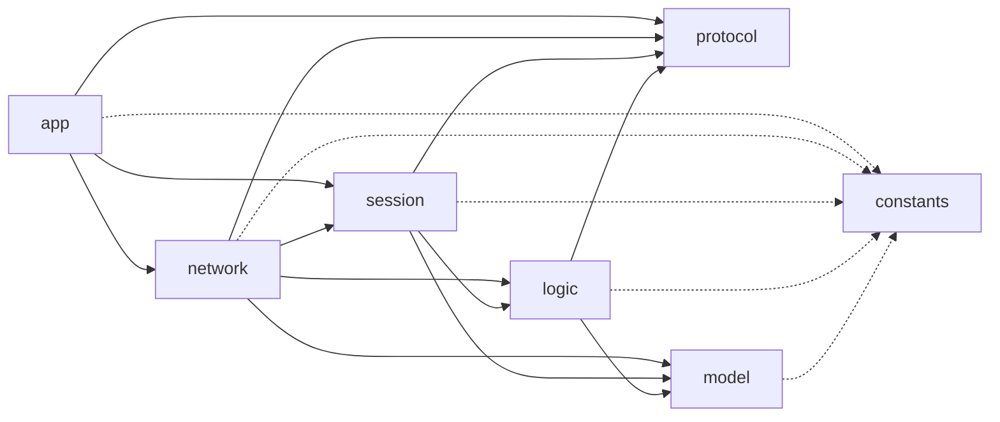
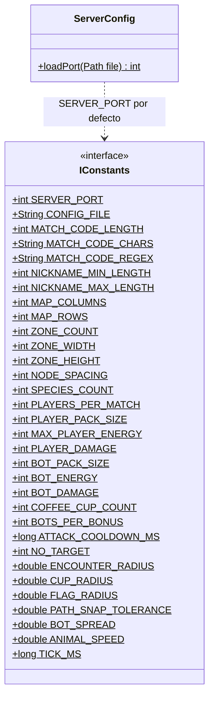
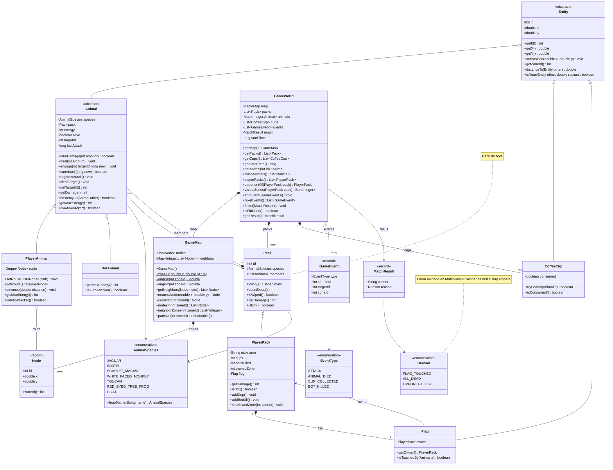
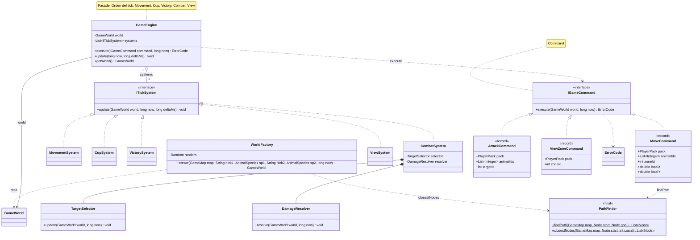
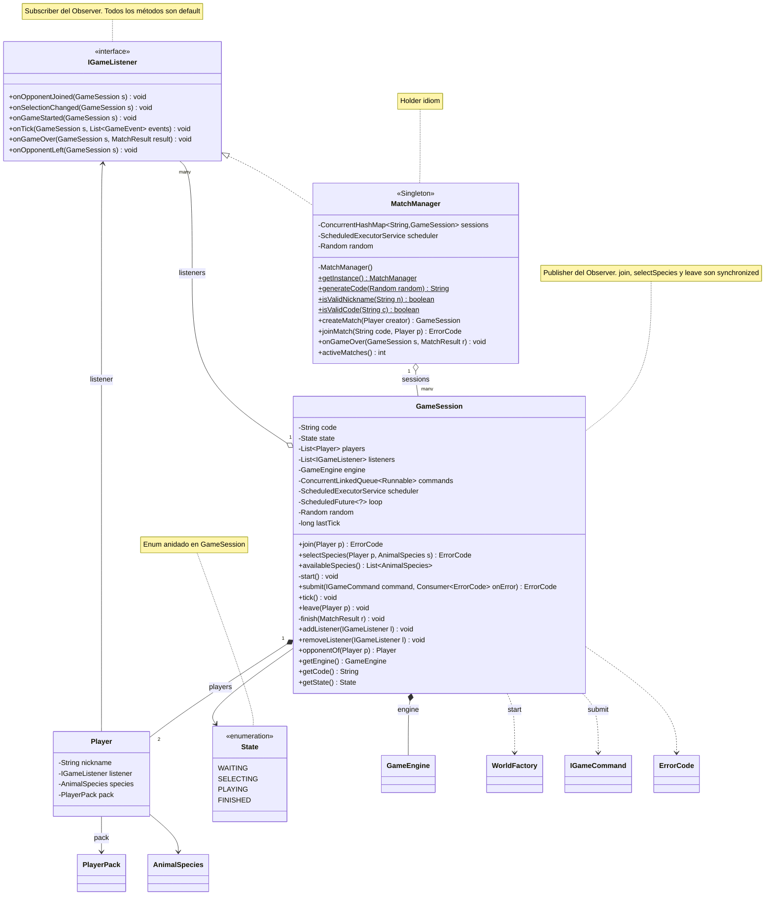
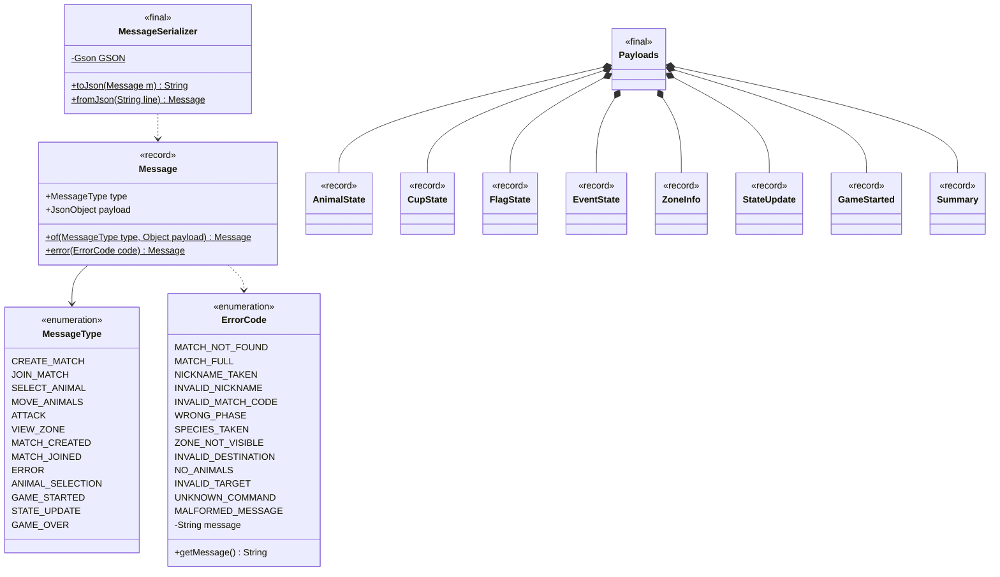
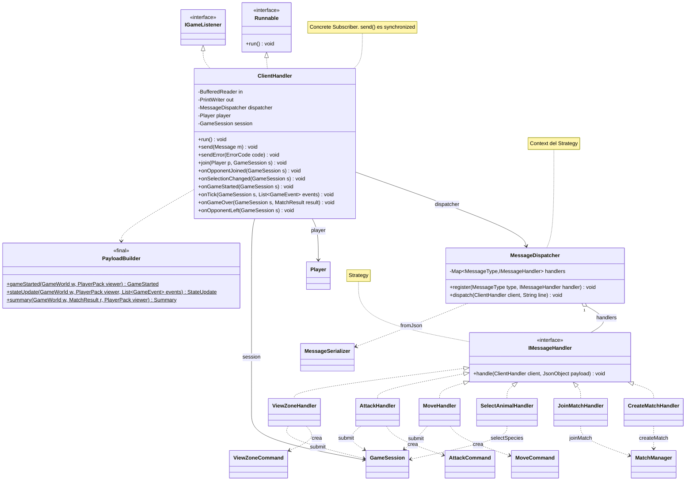
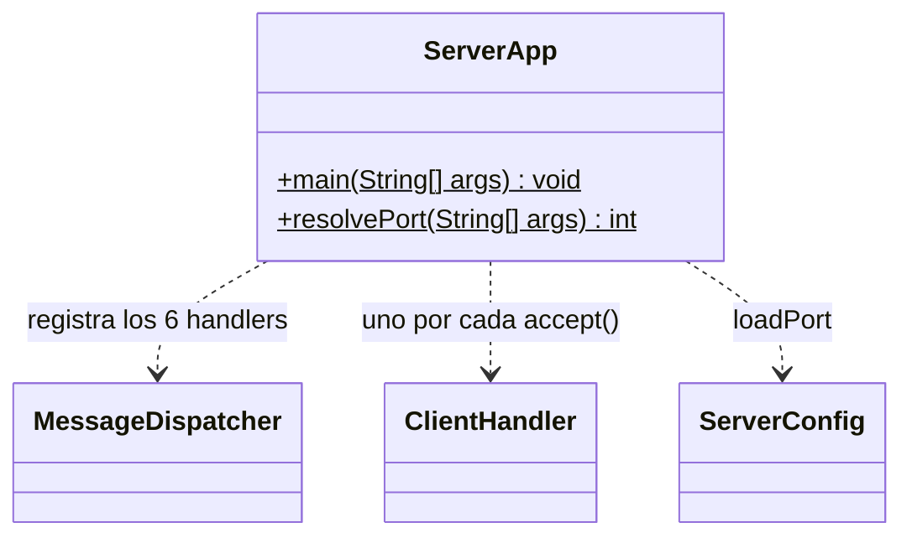

# Jungle Attack - Server

## Integrantes

* Andy Quiros Salazar
* Jordan Seas Alvarez

## Compilar y ejecutar

Requiere JDK 17 o superior. Desde la raíz del proyecto:

```sh
# compilar (Windows usa ; como separador; Linux/macOS usa :)
javac -d bin -cp lib/gson-2.11.0.jar src/*/*.java src/*/*/*.java

# ejecutar en el puerto por defecto (config.properties → 5050)
java -cp "bin;lib/*" app.ServerApp

# o con un puerto explícito
java -cp "bin;lib/*" app.ServerApp 6000
```

El puerto se resuelve en este orden: argumento → `server.port` de `config.properties` → `SERVER_PORT` (5050).

# Specs

### Vista general de paquetes



> `logic` se divide en dos subpaquetes: `logic.systems` (las fases del tick) y `logic.commands` (las acciones del jugador). GameEngine solo los coordina.

## Package: constants

**Clase principal testeable:** ServerConfig



```java
public interface IConstants

+int SERVER_PORT = 5050
+String CONFIG_FILE = "config.properties"
+int MATCH_CODE_LENGTH = 4
+String MATCH_CODE_CHARS = "ABCDEFGHIJKLMNOPQRSTUVWXYZ0123456789"
+String MATCH_CODE_REGEX = "[A-Za-z0-9]{4}"
+int NICKNAME_MIN_LENGTH = 3
+int NICKNAME_MAX_LENGTH = 16
+int MAP_COLUMNS = 4
+int MAP_ROWS = 3
+int ZONE_COUNT = MAP_COLUMNS * MAP_ROWS
+int ZONE_WIDTH = 800
+int ZONE_HEIGHT = 600
+int NODE_SPACING = 50 // la mitad de cada zona debe ser múltiplo de NODE_SPACING
+int SPECIES_COUNT = 7
+int PLAYERS_PER_MATCH = 2
+int PLAYER_PACK_SIZE = 10
+int MAX_PLAYER_ENERGY = 20
+int PLAYER_DAMAGE = 2
+int BOT_PACK_SIZE = 4
+int BOT_ENERGY = 10
+int BOT_DAMAGE = 1
+int COFFEE_CUP_COUNT = 10
+int BOTS_PER_BONUS = 2
+long ATTACK_COOLDOWN_MS = 1000
+int NO_TARGET = -1
+double ENCOUNTER_RADIUS = 40
+double CUP_RADIUS = 20
+double FLAG_RADIUS = 25
+double PATH_SNAP_TOLERANCE = 25 // qué tan lejos de un nodo puede caer un clic
+double BOT_SPREAD = 10 // separación visual de los bots alrededor de su nodo
+double ANIMAL_SPEED = 80 // unidades por segundo
+long TICK_MS = 100
```

```java
class ServerConfig
+static int loadPort(Path file) // lee server.port; si el archivo no existe o el valor no es válido, devuelve SERVER_PORT
```

## Package: model

**Clase principal testeable:** Animal (y GameMap)

> El modelo no solo guarda datos: cada objeto sabe hacer lo que le corresponde (avanzar por su ruta, ser recogido, ser tocado). Así esa lógica no se acumula en GameEngine.



```java
enum AnimalSpecies
JAGUAR, SLOTH, SCARLET_MACAW, WHITE_FACED_MONKEY, TOUCAN, RED_EYED_TREE_FROG, COATI
+static AnimalSpecies fromName(String name) // texto del JSON → especie
```

```java
enum EventType
ATTACK, ANIMAL_DIED, CUP_COLLECTED, BOT_KILLED
```

```java
record GameEvent(EventType type, int sourceId, int targetId, int zoneId)
```

```java
record MatchResult(String winner, Reason reason)
enum Reason { FLAG_TOUCHED, ALL_DEAD, OPPONENT_LEFT } // enum anidado; winner es null si hay empate
```

```java
record Node(int id, double x, double y) // punto del camino
+int zoneId() // GameMap.zoneOf(x, y)
```

```java
class GameMap
Se construye en el constructor: recorre los caminos horizontales y verticales y crea un nodo cada NODE_SPACING (las intersecciones se reutilizan).
-List<Node> nodes
-Map<Integer, List<Node>> neighbors // id del nodo → nodos vecinos
+GameMap() // genera la cuadrícula de caminos
+static int zoneOf(double x, double y) // fila * MAP_COLUMNS + columna
+static double originX(int zoneId), + static double originY(int zoneId) // esquina superior izquierda de la zona
+List<Node> getNeighbors(Node node)
+Node nearestNode(double x, double y) // nodo más cercano a un punto global
+Node centerOf(int zoneId)
+List<Node> nodesIn(int zoneId)
+List<Integer> neighborZones(int zoneId) // arriba, abajo, izquierda, derecha
+List<double[]> pathsOf(int zoneId) // segmentos de la zona en coordenadas locales {x1, y1, x2, y2}, para el cliente
```

```java
abstract class Entity
#int id · # double x · # double y // coordenadas globales
+int getId(), + double getX(), + double getY(), + void setPosition(double x, double y)
+int getZoneId() // GameMap.zoneOf(x, y)
+double distanceTo(Entity other)
+boolean isNear(Entity other, double radius) // misma zona y distancia ≤ radio
```

```java
abstract class Animal extends Entity
-AnimalSpecies species · - Pack pack · - int energy · - boolean alive
-int targetId // objetivo actual o NO_TARGET
-long lastAttack // para el cooldown
+boolean takeDamage(int amount) // resta energía (nunca baja de 0); devuelve true si murió con ese golpe
+void heal(int amount) // suma energía hasta getMaxEnergy(); no revive muertos
+void engage(int targetId, long now) // fija el objetivo; el primer golpe será 1 s después
+boolean canAttack(long now) // now - lastAttack >= ATTACK_COOLDOWN_MS
+void registerAttack() // lastAttack += ATTACK_COOLDOWN_MS
+void clearTarget(), + int getTargetId()
+int getDamage() // pack.getDamage()
+boolean isEnemyOf(Animal other) // pertenecen a packs distintos (dos bots nunca se atacan entre sí)
+abstract int getMaxEnergy() // polimorfismo
+abstract boolean isAutoAttacker() // polimorfismo: el bot ataca solo, el jugador no
```

```java
class PlayerAnimal extends Animal
-Deque<Node> route // nodos que le faltan por recorrer
+void setRoute(List<Node> path) // también cancela el ataque
+Deque<Node> getRoute()
+void advance(double distance) // avanza hacia el siguiente nodo de la ruta; si lo alcanza lo saca y sigue con el resto de la distancia
+int getMaxEnergy() → MAX_PLAYER_ENERGY · + boolean isAutoAttacker() → false
```

```java
class BotAnimal extends Animal
+int getMaxEnergy() → BOT_ENERGY · + boolean isAutoAttacker() → true
```

```java
class CoffeeCup extends Entity
-boolean consumed
+boolean tryCollect(Animal a) // si no está consumida y a.isNear(this, CUP_RADIUS): la consume y devuelve true
+boolean isConsumed()
```

```java
class Flag extends Entity
-PlayerPack owner · + PlayerPack getOwner()
+boolean isTouchedBy(Animal a) // a vivo, de un jugador distinto al dueño y a ≤ FLAG_RADIUS
```

```java
class Pack  (pack de bots)
#int id · # AnimalSpecies species · # List<Animal> members
+List<Animal> living() · + int countDead()
+boolean isWiped() // living().isEmpty()
+int getDamage() → BOT_DAMAGE // polimorfismo
+boolean isBot() → true
```

```java
class PlayerPack extends Pack
-String nickname · - int cups · - int botsKilled · - int viewedZone · - Flag flag
+int getDamage() → PLAYER_DAMAGE + cups (sobrescribe)
+boolean isBot() → false
+void addCup()
+void addBotKill() // si botsKilled % BOTS_PER_BONUS == 0, heal(1) a todos los vivos
getters y setViewedZone(int zoneId)
```

```java
class GameWorld
-GameMap map · - List<Pack> packs · - Map<Integer, Animal> animals · - List<CoffeeCup> cups
-List<GameEvent> events · - MatchResult result · - long startTime
+GameMap getMap() · + List<Pack> getPacks() · + List<CoffeeCup> getCups() · + long getStartTime()
+Animal getAnimal(int id)
+List<Animal> livingAnimals()
+List<PlayerPack> playerPacks()
+PlayerPack opponentOf(PlayerPack pack)
+Set<Integer> visibleZones(PlayerPack pack) // zonas con animales vivos del jugador
+void addEvent(GameEvent e) · + List<GameEvent> takeEvents() // devuelve y limpia
+void finish(MatchResult r) · + boolean isFinished() · + MatchResult getResult()
```

## Package: logic

> Todas las reglas del juego. Solo las ejecuta el hilo del tick de cada partida.
> GameEngine **no contiene reglas**: es una Facade que recibe comandos y recorre los sistemas en orden. Cada regla vive en su propia clase y se prueba por separado.

**Clases principales testeables:** CombatSystem, MoveCommand (y PathFinder)



```java
final class PathFinder  (utilidades static)
+static List<Node> findPath(GameMap map, Node start, Node goal) // BFS con un mapa de "padres"; lista vacía si no hay ruta
+static List<Node> closestNodes(GameMap map, Node start, int count) // BFS limitado; sirve para colocar a los 10 animales del jugador
```

```java
class WorldFactory
-Random random // se inyecta (semilla fija en las pruebas)
+GameWorld create(GameMap map, String nick1, AnimalSpecies sp1, String nick2, AnimalSpecies sp2, long now)
  1. Baraja las 12 zonas y toma 7 distintas.
  2. Jugadores: bandera en el centro de su zona y 10 animales en closestNodes(...).
  3. Bots: 4 animales en el centro de su zona, separados BOT_SPREAD.
  4. Tazas: 10 nodos al azar que no estén en zonas de jugadores ni repetidos.
```

```java
class GameEngine  (Facade)
-GameWorld world
-List<ITickSystem> systems // List.of(Movement, Cup, Victory, Combat, View): el orden de la lista es el orden del tick
+ErrorCode execute(IGameCommand command, long now) // command.execute(world, now); null si todo salió bien
+void update(long now, long deltaMs) // recorre systems; se detiene si world.isFinished()
+GameWorld getWorld()
```

### Subpaquete logic.systems

```java
interface ITickSystem
+void update(GameWorld world, long now, long deltaMs) // una fase del tick
```

```java
class MovementSystem implements ITickSystem
// a cada PlayerAnimal vivo con ruta: advance(ANIMAL_SPEED * deltaMs / 1000.0)

class CupSystem implements ITickSystem
// por cada taza libre y animal de jugador vivo: si cup.tryCollect(a) → pack.addCup() + evento CUP_COLLECTED

class VictorySystem implements ITickSystem
// 1) si la bandera de un jugador isTouchedBy(...) un animal del rival → finish(rival, FLAG_TOUCHED)
// 2) si un PlayerPack isWiped() → finish(rival, ALL_DEAD); si los dos → finish(null, ALL_DEAD) (empate)

class CombatSystem implements ITickSystem
-TargetSelector selector · - DamageResolver resolver
// selector.update(world, now) y luego resolver.resolve(world, now)

class ViewSystem implements ITickSystem
// si el viewedZone de un jugador ya no está en visibleZones(...), lo cambia a la zona de uno de sus animales vivos
```

```java
class TargetSelector
+void update(GameWorld world, long now)
// 1) los bots sin objetivo eligen el enemigo vivo más cercano a ≤ ENCOUNTER_RADIUS → engage(...)
// 2) se sueltan (clearTarget) los objetivos muertos o que quedaron fuera de ENCOUNTER_RADIUS

class DamageResolver
+void resolve(GameWorld world, long now)
// 1) acumula en un Map<Integer,Integer> los golpes de quienes tienen objetivo y canAttack(now) → registerAttack() + evento ATTACK
// 2) aplica todo junto (así dos animales que se pegan a la vez reciben su golpe aunque uno muera)
// 3) por cada muerte: evento ANIMAL_DIED; si era bot → addBotKill() al pack del atacante + evento BOT_KILLED
```

### Subpaquete logic.commands

```java
interface IGameCommand  (Command)
+ErrorCode execute(GameWorld world, long now) // null si todo salió bien
```

```java
record MoveCommand(PlayerPack pack, List<Integer> animalIds, int zoneId, double localX, double localY) implements IGameCommand
// 1) zoneId debe estar en visibleZones(pack) → si no ZONE_NOT_VISIBLE
// 2) pasa a coordenadas globales y busca nearestNode; si está a más de PATH_SNAP_TOLERANCE → INVALID_DESTINATION
// 3) a cada animal vivo y propio: setRoute(PathFinder.findPath(...)); si ninguno sirvió → NO_ANIMALS

record AttackCommand(PlayerPack pack, List<Integer> animalIds, int targetId) implements IGameCommand
// el objetivo existe, está vivo y no es propio → si no INVALID_TARGET
// engage(...) solo a los animales propios y vivos que ya están a ≤ ENCOUNTER_RADIUS

record ViewZoneCommand(PlayerPack pack, int zoneId) implements IGameCommand
// si zoneId está en visibleZones(pack) → setViewedZone; si no ZONE_NOT_VISIBLE
```

## Package: session

**Clase principal testeable:** GameSession

> Todos los métodos de IGameListener son default (vacíos), así cada suscriptor sobrescribe solo los que le interesan.



```java
interface IGameListener  (Subscriber del Observer)
+default void onOpponentJoined(GameSession s)
+default void onSelectionChanged(GameSession s)
+default void onGameStarted(GameSession s)
+default void onTick(GameSession s, List<GameEvent> events)
+default void onGameOver(GameSession s, MatchResult result)
+default void onOpponentLeft(GameSession s)
```

```java
class Player
-String nickname · - IGameListener listener · - AnimalSpecies species · - PlayerPack pack
getters y setters
```

```java
class GameSession  (Publisher del Observer)
-String code · - State state // enum State { WAITING, SELECTING, PLAYING, FINISHED } anidado
-List<Player> players · - List<IGameListener> listeners
-GameEngine engine · - ConcurrentLinkedQueue<Runnable> commands
-ScheduledExecutorService scheduler · - ScheduledFuture<?> loop · - Random random · - long lastTick
+synchronized ErrorCode join(Player p) // MATCH_FULL, NICKNAME_TAKEN; con 2 jugadores → onOpponentJoined + onSelectionChanged
+synchronized ErrorCode selectSpecies(Player p, AnimalSpecies s) // WRONG_PHASE, SPECIES_TAKEN; cuando eligen los dos → start()
+List<AnimalSpecies> availableSpecies()
-void start() // WorldFactory + onGameStarted + programa tick() cada TICK_MS
+ErrorCode submit(IGameCommand command, Consumer<ErrorCode> onError)
  // si state != PLAYING → WRONG_PHASE de inmediato
  // si no, encola () -> { e = engine.execute(command, now); if (e != null) onError.accept(e); } y devuelve null
+void tick() // ejecuta los comandos encolados, engine.update(...), onTick(...), y termina si hay ganador. Atrapa RuntimeException para que el scheduler no se detenga
+synchronized void leave(Player p) // en juego: encola la victoria del rival (OPPONENT_LEFT); antes: cancela y avisa onOpponentLeft
-void finish(MatchResult r) // cancela el loop + onGameOver
+void addListener(IGameListener l) · + void removeListener(IGameListener l)
+Player opponentOf(Player p) · + GameEngine getEngine() · + String getCode() · + State getState()
```

```java
class MatchManager implements IGameListener  (Singleton, *holder idiom*)
-static class Holder // guarda INSTANCE; la JVM lo crea una sola vez y de forma segura entre hilos, sin locks (Week #10, sección 1.5)
-ConcurrentHashMap<String, GameSession> sessions
-ScheduledExecutorService scheduler // compartido por todas las partidas
-Random random
-MatchManager() // constructor privado
+static MatchManager getInstance()
+static String generateCode(Random random) // 4 caracteres de MATCH_CODE_CHARS
+static boolean isValidNickname(String n) · + static boolean isValidCode(String c)
+GameSession createMatch(Player creator) // repite generateCode hasta que putIfAbsent lo acepte (operación atómica, no hay códigos repetidos)
+ErrorCode joinMatch(String code, Player p) // MATCH_NOT_FOUND o el error de join
+void onGameOver(GameSession s, MatchResult r) // elimina la partida del mapa
+int activeMatches()
```

## Package: protocol

> Contrato JSON con el cliente. No depende de ningún otro paquete del servidor.
> Cada mensaje es **una línea** de JSON: `{"type": "...", "payload": {...}}`.

**Clase principal testeable:** MessageSerializer

### Mensajes

| Tipo | Dirección | Payload |
|---|---|---|
| CREATE_MATCH | cliente → servidor | `{ nickname }` |
| JOIN_MATCH | cliente → servidor | `{ nickname, code }` |
| SELECT_ANIMAL | cliente → servidor | `{ species }` |
| MOVE_ANIMALS | cliente → servidor | `{ animalIds, zoneId, x, y }` (x, y locales a la zona) |
| ATTACK | cliente → servidor | `{ animalIds, targetId }` |
| VIEW_ZONE | cliente → servidor | `{ zoneId }` |
| MATCH_CREATED | servidor → cliente | `{ code }` |
| MATCH_JOINED | servidor → cliente | `{ code, opponent }` (se envía a los dos jugadores) |
| ERROR | servidor → cliente | `{ code, message }` |
| ANIMAL_SELECTION | servidor → cliente | `{ available, opponentChoice }` |
| GAME_STARTED | servidor → cliente | `Payloads.GameStarted` |
| STATE_UPDATE | servidor → cliente | `Payloads.StateUpdate` (cada TICK_MS) |
| GAME_OVER | servidor → cliente | `Payloads.Summary` |

### Códigos de error

| Código | Mensaje |
|---|---|
| MATCH_NOT_FOUND | No existe una partida con ese código |
| MATCH_FULL | La partida ya tiene dos jugadores |
| NICKNAME_TAKEN | Ese apodo ya está en uso en la partida |
| INVALID_NICKNAME | El apodo debe tener entre 3 y 16 caracteres |
| INVALID_MATCH_CODE | El código debe tener 4 letras o números |
| WRONG_PHASE | Esa acción no se puede hacer en este momento |
| SPECIES_TAKEN | Esa especie ya fue elegida |
| ZONE_NOT_VISIBLE | No hay animales tuyos vivos en esa zona |
| INVALID_DESTINATION | El destino no está sobre un camino |
| NO_ANIMALS | Ninguno de los animales seleccionados puede moverse |
| INVALID_TARGET | Ese objetivo no se puede atacar |
| UNKNOWN_COMMAND | Comando desconocido |
| MALFORMED_MESSAGE | El mensaje no tiene el formato esperado |



```java
enum MessageType
CREATE_MATCH, JOIN_MATCH, SELECT_ANIMAL, MOVE_ANIMALS, ATTACK, VIEW_ZONE // cliente → servidor
MATCH_CREATED, MATCH_JOINED, ERROR, ANIMAL_SELECTION, GAME_STARTED, STATE_UPDATE, GAME_OVER // servidor → cliente
```

```java
enum ErrorCode
Los códigos de la tabla "Códigos de error"
-String message // texto en español · + String getMessage()
```

```java
record Message(MessageType type, JsonObject payload)
+static Message of(MessageType type, Object payload) // convierte cualquier objeto a JsonObject con Gson
+static Message error(ErrorCode code) // payload { code, message }
```

```java
final class MessageSerializer
-static final Gson GSON
+static String toJson(Message m) // una sola línea
+static Message fromJson(String line) // lanza JsonParseException si el JSON es inválido
```

```java
final class Payloads
// Un solo archivo con los record de respuesta. Las coordenadas siempre son locales a la zona.
// packType es relativo a quien recibe: "PLAYER", "OPPONENT" o "BOT"
record AnimalState(int id, int packId, String species, String packType, double x, double y, int energy, boolean alive)
record CupState(int id, double x, double y)
record FlagState(String owner, double x, double y) // owner: "PLAYER" u "OPPONENT"
record EventState(String type, int sourceId, int targetId)
record ZoneInfo(int id, List<Integer> neighbors, List<double[]> paths)
record StateUpdate(long serverTime, int zoneId, List<Integer> visibleZones, List<AnimalState> animals,
                   List<CupState> cups, List<FlagState> flags, int damage, int cupsConsumed, int botsKilled, List<EventState> events)
record GameStarted(int zoneWidth, int zoneHeight, List<ZoneInfo> zones, String opponent,
                   String species, String opponentSpecies, StateUpdate initial)
record Summary(String winner, String reason, long durationMs, int botsKilled,
               Map<Integer, Integer> deathsByPack, int playerCups, int opponentCups)
```

## Package: network

**Clase principal testeable:** MessageDispatcher



```java
class ClientHandler implements Runnable, IGameListener  (Concrete Subscriber)
-BufferedReader in · - PrintWriter out // UTF-8; se reciben en el constructor (en las pruebas se usan StringReader y StringWriter)
-MessageDispatcher dispatcher
-Player player · - GameSession session // null mientras está en el lobby
+void run() // lee línea por línea → dispatcher.dispatch(this, ...); en finally: session.leave(player) y cierra todo
+synchronized void send(Message m) // sincronizado: escriben este hilo y el hilo del tick
+void sendError(ErrorCode code)
+void join(Player p, GameSession s) // guarda la partida actual
Sobrescribe los 6 métodos de IGameListener: arma el mensaje con PayloadBuilder y lo envía
onGameOver y onOpponentLeft además dejan session = null (el cliente vuelve al lobby y puede crear otra partida)
```

```java
final class PayloadBuilder  (utilidades static)
+static Payloads.GameStarted gameStarted(GameWorld w, PlayerPack viewer) // mapa + estado inicial
+static Payloads.StateUpdate stateUpdate(GameWorld w, PlayerPack viewer, List<GameEvent> events) // solo la zona que mira, en coordenadas locales y con packType relativo
+static Payloads.Summary summary(GameWorld w, MatchResult r, PlayerPack viewer)
```

```java
interface IMessageHandler  (Strategy)
+void handle(ClientHandler client, JsonObject payload)
```

```java
class MessageDispatcher  (Context del Strategy)
-Map<MessageType, IMessageHandler> handlers
+void register(MessageType type, IMessageHandler handler)
+void dispatch(ClientHandler client, String line) // fromJson → busca el handler. Si no hay → UNKNOWN_COMMAND. Si hay error de JSON o falta un campo → MALFORMED_MESSAGE
```

```java
Handlers (todos implements IMessageHandler, ~10 líneas cada uno)
CreateMatchHandler // valida el apodo (INVALID_NICKNAME) → MatchManager.createMatch → MATCH_CREATED
JoinMatchHandler // valida el apodo y el código (INVALID_MATCH_CODE) → MatchManager.joinMatch
SelectAnimalHandler // session.selectSpecies(...)
MoveHandler // arma MoveCommand → session.submit(cmd, client::sendError); si devuelve error → sendError
AttackHandler // arma AttackCommand → session.submit(cmd, client::sendError)
ViewZoneHandler // arma ViewZoneCommand → session.submit(cmd, client::sendError)
```

## Package: app

**Clase principal testeable:** ServerApp (método resolvePort)



```java
class ServerApp
+static void main(String[] args) // registra los 6 handlers, abre el ServerSocket (try-with-resources) y por cada accept() envía un ClientHandler al pool de hilos
+static int resolvePort(String[] args) // argumento → config.properties → SERVER_PORT
```

## Decisiones de diseño

### GameEngine distribuido
En la primera versión GameEngine validaba comandos, movía, recogía tazas, revisaba victoria, resolvía combate y corregía vistas. Ahora:
- Cada fase del tick es un `ITickSystem` independiente. GameEngine solo recorre la lista en orden.
- Cada acción del jugador es un `IGameCommand` (patrón Command). Los handlers lo crean y la sesión lo encola.
- La lógica que le pertenece a un objeto vive en ese objeto: `PlayerAnimal.advance`, `CoffeeCup.tryCollect`, `Flag.isTouchedBy`, `Pack.isWiped`.

Así, agregar una regla nueva es agregar un sistema a la lista sin tocar los demás, y cada regla se prueba sola con un `GameWorld` armado a mano.

### Reparto cliente / servidor
El servidor es la autoridad de todo lo que afecta el resultado (movimiento, combate, tazas y victoria) para que un cliente no pueda hacer trampa. El cliente se encarga de lo demás y evita mandar mensajes que se sabe que fallarían:

| Lo hace el cliente | Lo hace el servidor |
|---|---|
| Validar apodo y código antes de enviar | Volver a validar (nunca confiar en el cliente) |
| Selección de animales (clic y arrastre) | Rutas con BFS y movimiento |
| Revisar que el destino esté sobre un camino | Combate, cooldown y daño |
| No atacar animales propios | Tazas, bonificaciones y victoria |
| Cambiar solo a zonas visibles | Decidir qué zona ve cada jugador |
| Interpolar posiciones a 30 FPS | Enviar el estado cada 100 ms |

### Movimiento con X, Y sobre un grafo de nodos
El mapa ya funciona como una cuadrícula: los caminos se discretizan en nodos cada `NODE_SPACING` y el BFS trabaja sobre ese grafo, no sobre el plano continuo. Las coordenadas X, Y solo se usan para que el movimiento entre nodos se vea fluido y para los radios de encuentro, tazas y bandera. Con celdas puras el BFS sería igual, pero los animales saltarían de celda en celda y los radios tendrían que expresarse en celdas.

### PlayerPack extends Pack
Un pack de bots y un pack de jugador comparten miembros, especie, `living()` y `countDead()`, y difieren en el daño (`getDamage()` polimórfico). Por eso se dejó la herencia. Si el pack del jugador creciera mucho, la alternativa sería que `PlayerPack` *contenga* un `Pack` (composición) en vez de extenderlo.
